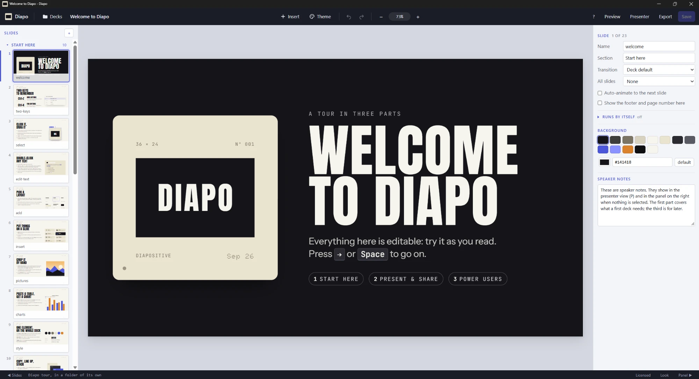
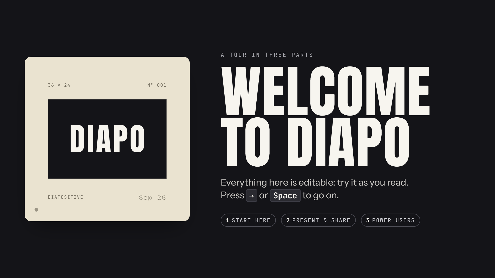
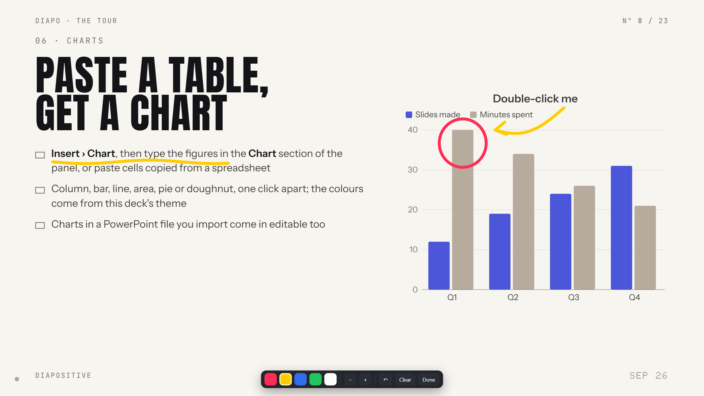
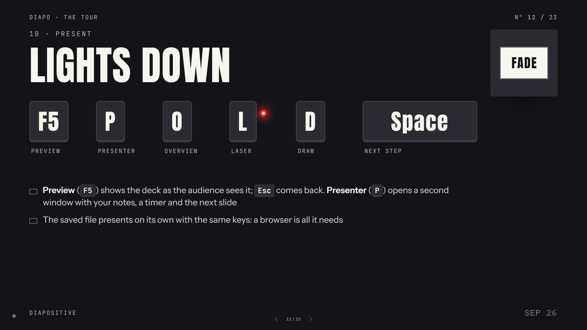

<p align="center">
  
</p>

<p align="center"><b>Brilliant slides. Forever.</b><br>
Edit HTML presentations the way you edit slides.</p>




Some time ago I sat down at my laptop to prepare a presentation for a lab meeting. I had some cool new results and was
looking forward to showing them to my colleagues.

I have been using the Plotly library in Python to make interactive graphs, because being able to hover over data
points to see where they were coming from, zoom into parts of the data, or hide datasets was helping me immensely
during data analysis. Of course, you can't embed code in PowerPoint, so what I was doing was basically making several
variations of the same plot and exporting them as static images. That's fine, and it's what I've been doing my whole
career, but it left me wondering.

At the same time, videos about HTML slide decks, and about building them with AI models, started showing up in my
YouTube feed, so I decided to give it a shot: I gave Claude some directions and the code for one of those plots, to see
if I could make use of it.

The first result amazed me. I was getting the interactivity of Plotly back, and it was perfect for a lab meeting setting 
(which is more of a conversation and back-and-forth with colleagues) where you can actually manipulate the charts live while explaining things.

The only annoying thing was that if I wanted to change something, I had to either edit the code or ask the AI, and
neither felt right. I'm ok with code, but I don't have a good feeling for what the values should be when moving stuff
around, for example. I guess I'm just too used to the visual, instant feedback you get while working in PowerPoint.
On the other hand, asking an AI model for (sometimes small) changes felt like too much extra work for both me and for the
datacenter, and probably wasn't worth it, especially when the result was different from what I had in mind (the haters would say "skill issue", but anyway).

So I started looking for editors, but most of them were cloud based, like slides.com, which makes sense for the kind
of business model they are running, but I didn't care much for any of that. I just wanted something simple and local that worked for me, and Diapo was born out of that need.


## What it does

If you've used PowerPoint, Google Slides, or similar product, you already know how to use Diapo. You click, drag, resize, rotate and retype things right
on the slide, and set themes, fonts, colours, animations, transitions, charts, tables, icons, from the panel beside it.

Adding equations (LaTeX) and chemical structures (SMILES) is also supported.

Underneath, though, the deck is still a web page, so it can do everything a web page can. Interactive figures drawn
by the deck's own scripts, Plotly graphs for example, run once you trust the deck, and you move and resize them like
anything else. AI models are quite good at adding effects and transitions to your slides, if you are into that sort of thing.

Each deck can be exported into a single .html file, which can be opened in any modern browser.

I'm not 100% happy with it yet but it's in a decent functional state and some colleagues and friends were eager to try and play around with it, so I'm throwing it out there.

## Presenting

Press **F5** and the deck fills the screen. Everything you need while talking is a key away: **P** opens a presenter
view with your notes, a timer and the next slide, **O** shows all the slides at once, and the steps you set up are
revealed one at a time.



Press **D** to draw on the slide, to circle the number that matters or underline what you're talking about, and
**L** for a laser pointer. The drawings disappear when you're done and never end up in the file. (but I'm thinking if I should give the option of saving them as well, undecided yet)

<p>
  
  
</p>

## Bringing your stuff along

You can import PowerPoint (.pptx) and Markdown files, and export a deck as a PDF, as a handout with your speaker
notes, as a single self-contained HTML file, or back to an editable PowerPoint file.

AI-drafted decks open like any other, as long as they follow the [Diapo Format](diapo-format/README.md). The
[`diapo-deck`](skills/diapo-deck) skill teaches Claude Code to write them, so an assistant can draft the deck and you
can do the last touches by hand, which is exactly the workflow I was after.

## Nothing leaves your computer

Diapo runs locally: no account, no sign-in, no telemetry. It only goes online when you look up a Google Font or put a
video or web page from elsewhere on a slide. Your decks stay in the folders you keep them in.

## Getting started

On Windows, the simplest route is the program itself. Download `diapo.exe` from the
[Releases](../../releases) page and double-click it; you don't need to install anything, Python included. The file
isn't signed yet, so Windows may warn you the first time that it comes from an unknown publisher.

On any system, Diapo also runs from this repository. All it needs is Python 3.8 or newer:

1. Download the repository (**Code > Download ZIP**, then unzip it), or clone it.
2. In the `deck-editor` folder, double-click `Start Diapo.bat` on Windows or `Start Diapo.command` on macOS (the
   first time, right-click > Open), or run `./start-diapo.sh` on Linux. From a terminal,
   `python3 deck-editor/serve.py [folder]` does the same (`py -3` on Windows).
3. Choose **Try the sample deck** for a tour (the one in the screenshots above), or **New** to start from a blank deck
   or from one of 31 designs.

Diapo looks for Chrome or Edge first, because either one gives it a window of its own and prints PDFs directly.
Without them, it opens in a tab of your default browser, Firefox included, and PDFs are saved through the browser's
print dialog; only the picker for fonts installed on your computer needs Chrome or Edge. Started from the repository
for the first time, Diapo opens the `workspace/` folder.

## Documentation

- [Diapo in ten minutes](deck-editor/GUIDE.md), the short guide for people who make presentations.
- [Reference](deck-editor/REFERENCE.md), which covers every feature, the deck file contract, the keyboard, the server
  and the tests.
- [Diapo Format](diapo-format/README.md), the file format every deck follows, for anyone who wants to make decks
  without the editor.
- [Changelog](deck-editor/CHANGELOG.md).

## What is in this repository

| Folder | What it is |
|---|---|
| [`deck-editor/`](deck-editor) | The editor: plain HTML, CSS and JavaScript for the app, a server written with the Python standard library, and the tests |
| [`diapo-format/`](diapo-format) | The base styles, controller and runtime that every deck carries, published on their own |
| [`skills/`](skills) | The `diapo-deck` skill, with which Claude Code writes decks that Diapo can edit |

## Development

The app has no build step and installs nothing when it runs. npm is needed only for the tests and for the tools
that copy the icon, maths and chemistry libraries into the app:

```
cd deck-editor
npm install              # Playwright, and the packages the build tools copy from
npm test                 # browser tests in Chrome
npm run test:firefox     # the same tests in Firefox (once before: npx playwright install firefox)
npm run test:py          # Python tests (Windows; elsewhere run the same unittest command with python3)
```

[Tests](deck-editor/REFERENCE.md#tests), in the reference, describes the rest.

## Why "Diapo"?

In Italian, slides are *diapositive*, and everyone just calls them *diapo*. Before projectors were plugged into
laptops, a diapositiva was a real thing you could hold: a small piece of 35 mm film, 36 × 24 mm, set in a plastic frame, which a projector threw onto a white screen in a dark room. I thought it fitting to use it as the Diapo logo as well.
I loved the ritual of setting those things up with my father when I was young so the name resonates a lot with me, but it might not have the same effect on people from outside of Italy. I still think the name is fun!


## AI Use

Diapo was built almost entirely with Claude Opus 5 and more recently with Opus 5.5. Some of the text you will read is slop-heavy (e.g. the test presentation is Claude-generated with small modifications), will try to clean some of that up over time but I don't find myself having much time these days :P

## Licence

Diapo is open source under the [MIT licence](LICENSE), by Daniele Rossetto. The decks you make are yours, and the
format they follow is published separately under the same licence, so no deck depends on Diapo to be shown.
Work by other authors that Diapo includes (templates, icons, fonts, and the MathJax and SmilesDrawer libraries) is
listed with its licence in [THIRD-PARTY-NOTICES.md](THIRD-PARTY-NOTICES.md).
