<p align="center">
  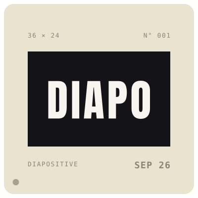
</p>

<p align="center"><b>Brilliant slides. Forever.</b><br>
Edit HTML presentations the way you edit slides.</p>

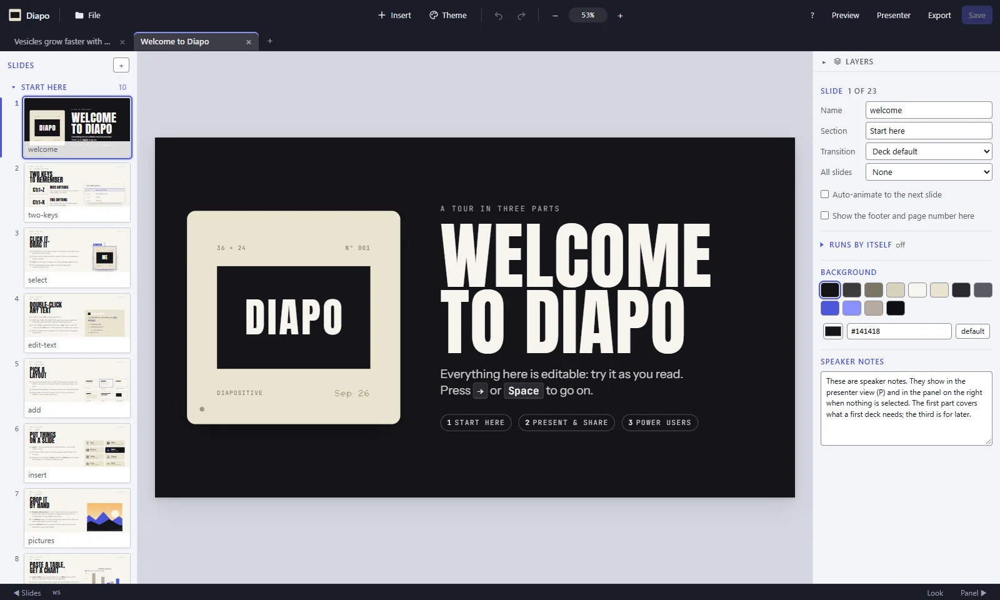


Some time ago I sat down at my laptop to prepare a presentation for a lab meeting. I had some cool new results and was
looking forward to showing them to my colleagues.

I have been using the Plotly library in Python to make interactive graphs, because being able to hover over data
points to see where they were coming from, zoom into parts of the data, or hide datasets was helping me immensely
during data analysis. Of course, you can't embed code in PowerPoint, so what I was doing was basically making several
variations of the same plot and exporting them as static images. That's fine, and it's what I've been doing my whole
career, but it left me wondering.

At the same time, videos about HTML slide decks, and about building them with AI models, started showing up in my
YouTube feed, so I decided to give it a shot: I gave Claude some directions and the code for one of those plots, to see
if I could make use of it.

The first result amazed me. I was getting the interactivity of Plotly back, and it was perfect for a lab meeting setting
(which is more of a conversation and back-and-forth with colleagues) where you can actually manipulate the charts live while explaining things.

The only annoying thing was that if I wanted to change something, I had to either edit the code or ask the AI, and
neither felt right. I'm ok with code, but I don't have a good feeling for what the values should be when moving stuff
around, for example. I guess I'm just too used to the visual, instant feedback you get while working in PowerPoint.
On the other hand, asking an AI model for (sometimes small) changes felt like too much extra work for both me and for the
datacenter, and probably wasn't worth it, especially when the result was different from what I had in mind (the haters would say "skill issue", but anyway).

So I started looking for editors, but most of them were cloud based, like slides.com, which makes sense for the kind
of business model they are running, but I didn't care much for any of that. I just wanted something simple and local that worked for me, and Diapo was born out of that need.


## What it does

If you've used PowerPoint, Google Slides, or a similar product, you already know how to use Diapo. You click, drag,
resize, rotate and retype things right on the slide, and set themes, fonts, colours, animations and transitions from
the panel beside it.

Underneath, though, the deck is still a web page, so it can do everything a web page can. A saved deck is one HTML
file that opens in any modern browser, presents on its own, and doesn't need Diapo to be shown.

You don't have to start from a blank page: **New deck** opens a gallery of 31 designs, light and dark, formal and
playful, each one a full deck with layouts you can reuse.


The look of one design can also be put on any deck you already have, in one click and one undo step (Theme >
**Looks from the designs**).

## Made for talks with data in them

This is the reason I originally built Diapo for!

**Charts go beyond simple pictures.** Column, bar, line, area, pie, doughnut and scatter charts are drawn from a
table you can paste straight from a spreadsheet. They get error bars (paste a table with an SD or SEM column and
they're there), axis titles, log scales, trend lines with R² on scatter plots. They follow the deck's colours and fonts, and go to PowerPoint as native, editable charts.

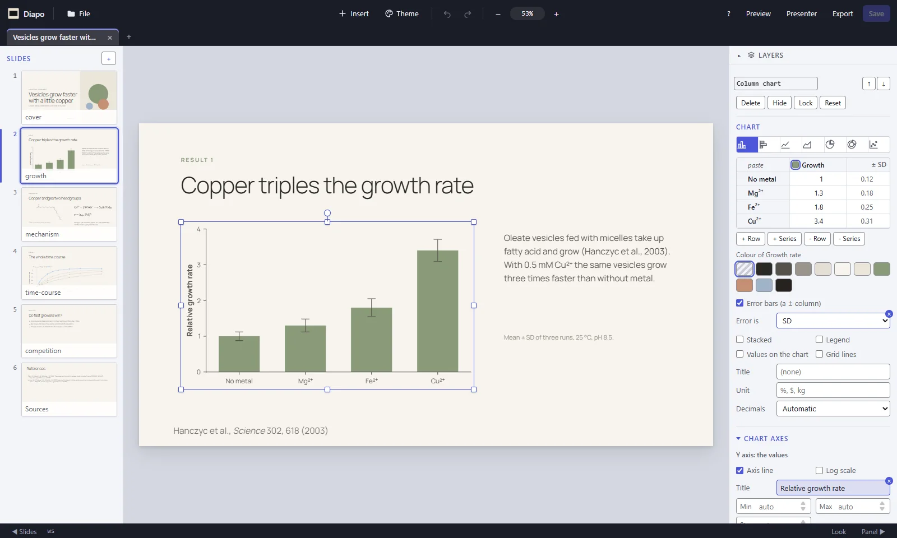

**Interactive Plotly charts.** Paste what `fig.to_json()` gives you, or pick the page `fig.write_html()` saved. On the
slide it moves and resizes like a picture; when you present it is live: hover over a point, zoom, click the legend to
hide a series. The PDF and the slide thumbnails get a picture of it.

<p>
  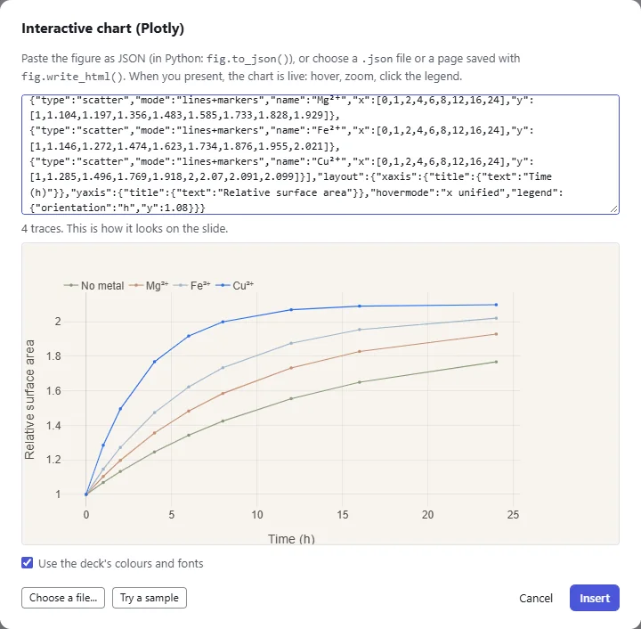
  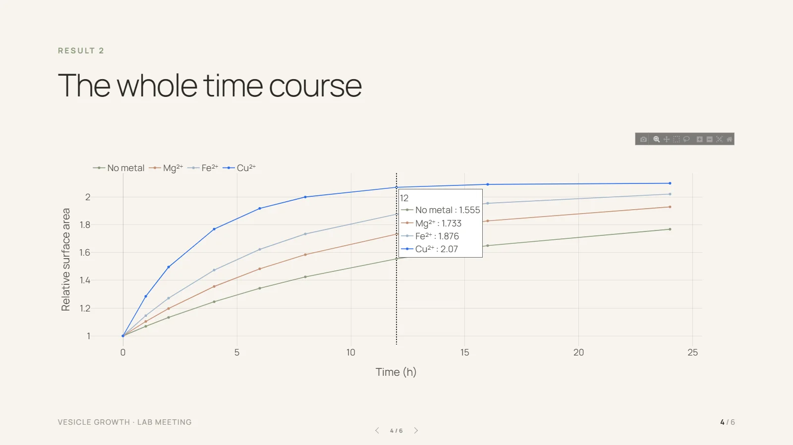
</p>

**Equations and chemical structures.** Equations are written in LaTeX (reactions too, with `\ce{}`), with buttons for
the symbols you can't find easily on the keyboard. They also go inside a sentence: press **Alt+=** while typing, or type `\(k_{obs}\)`
and press Alt+= to turn it into maths. Chemical structures come from SMILES, as ChemDraw, Marvin or PubChem give it,
with the molecular formula in the panel. Both are saved as plain drawings, so they print and show anywhere without
a script or a font.

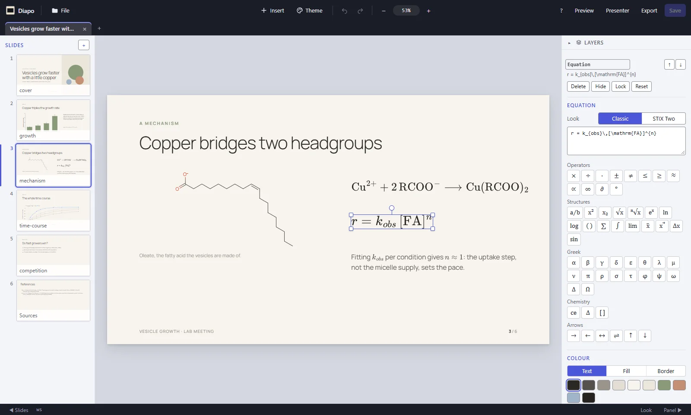

**Citations.** Import your library from Zotero, Mendeley or JabRef (`.bib`, RIS or CSL-JSON), or add a paper by its
DOI. While typing, **Alt+[** or `[@` finds a reference and puts the citation in. Each slide can list what it cites at
its foot, and the **Sources slide** collects every reference and picture credit and keeps itself up to
date. APA by default; Nature, Science, Cell, PNAS, ACS, RSC, IEEE, Vancouver, Chicago and others are a click away,
or bring your own `.csl` file.

<p>
  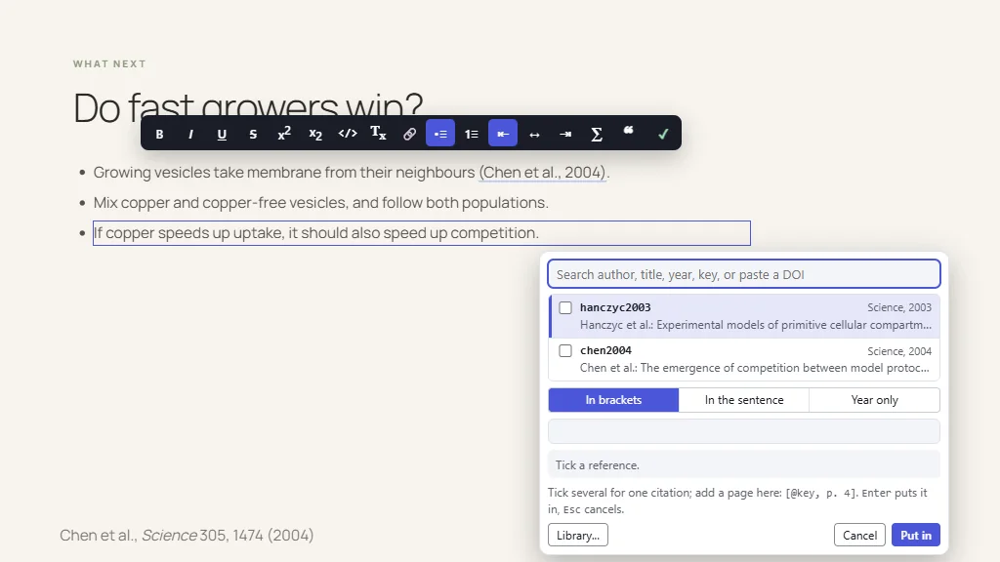
  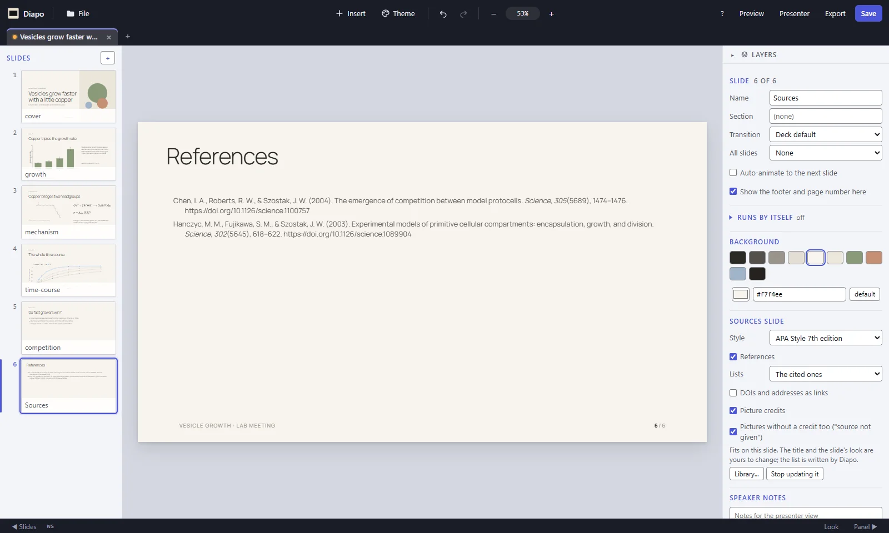
</p>

## Presenting

Press **F5** and the deck fills the screen. Everything you need while talking is a key away: **P** opens a presenter
view with your notes, a timer and the next slide, **O** shows all the slides at once, and the steps you set up are
revealed one at a time.

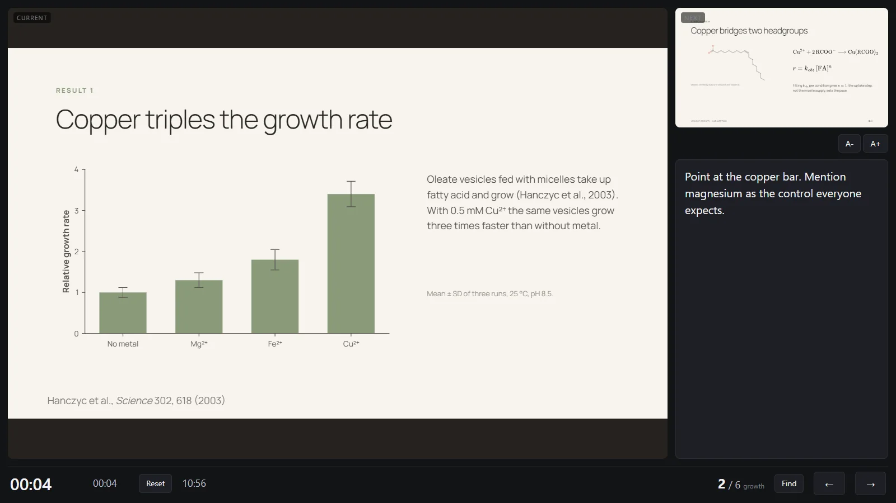

When someone asks to see "the slide with the copper data again", press **Ctrl+Shift+F** (or **/**) and type: the
overview keeps the slides that match, and Enter goes there. Typing a slide's number and Enter works too. The
presenter window's **Find** also searches your notes, out of the audience's sight.

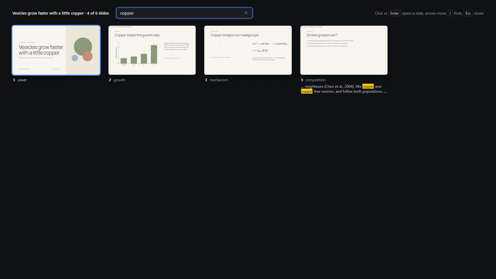

Press **D** to draw on the slide, to circle the number that matters or underline what you're talking about, and
**L** for a laser pointer. The drawings disappear when you're done and never end up in the file. (but I'm thinking if I should give the option of saving them as well, undecided yet)

<p>
  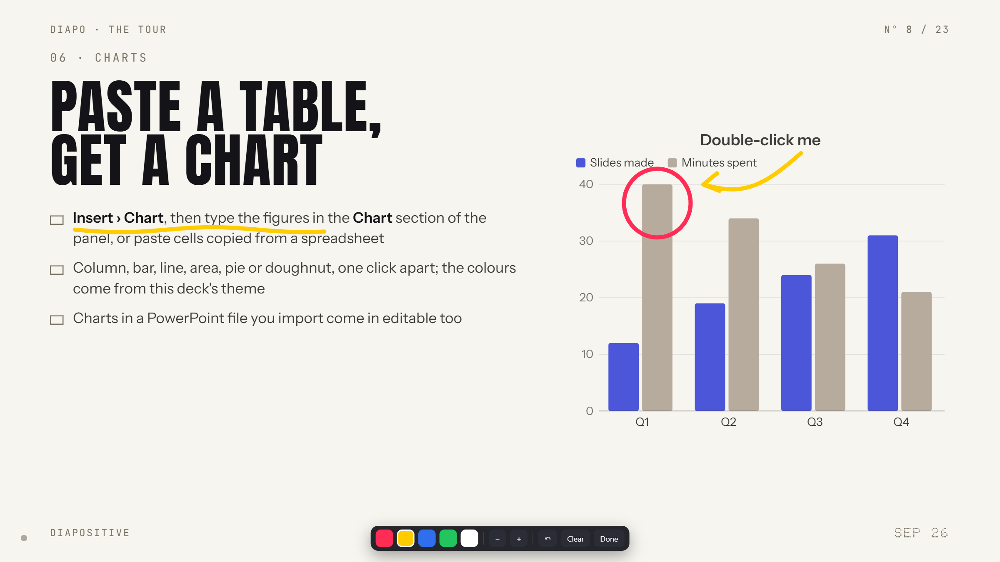
  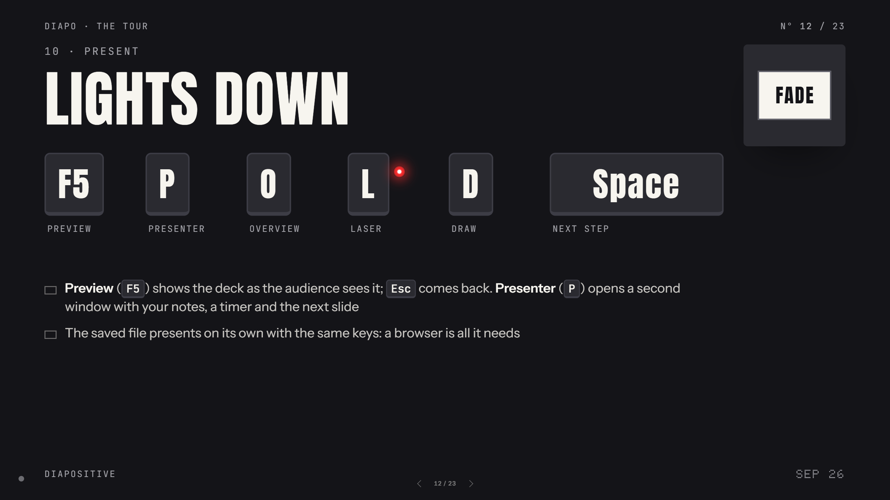
</p>

All of this works in the saved file on any computer, without Diapo: press **?** in a deck to see the keys. While a
deck is in front, the screen stays on and the computer doesn't go to sleep, so a slide can stay up while people talk.

## The small things that make it fast

A lot of the work on Diapo went into things that are easy to miss but that will make your life much better when you start using them:

- **Ctrl+K finds anything.** Every action, every slide by name, every layout, icon, font and design, by typing a
  few letters of it.
- **Ctrl+M adds a slide with a layout** (title, two columns, comparison, image and caption, big number...), built
  from the deck's own fonts and colours.

<p>
  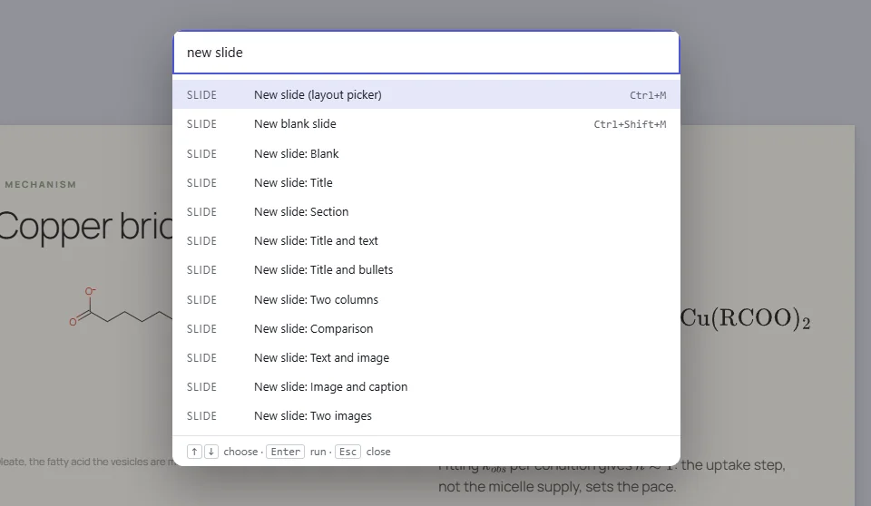
  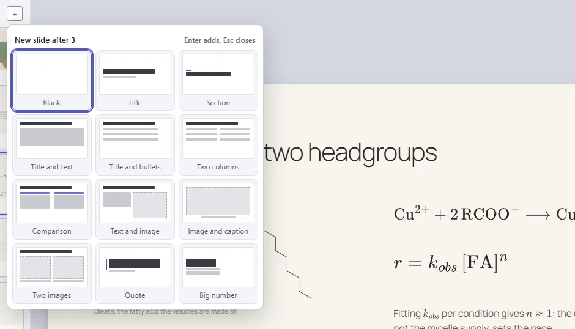
</p>

- **Things land in a free spot.** A new chart, equation or picture goes to the centre when it's free, otherwise to
  the nearest clear place, instead of piling up on top of each other.
- **Drag files onto the slide.** Pictures, video and sound land where you drop them; a PowerPoint or Markdown file
  dropped into the window becomes a new deck.
- **Paste from anywhere.** A table pasted into a chart fills it, an image address becomes a picture, a YouTube link
  a player, and text from Word or a web page keeps its bold, colours and links (Ctrl+Shift+V for plain text).
- **Smart guides and snapping** line things up with each other and with the slide while you drag (hold Ctrl to stop
  snapping); Look > Rulers and guides adds guides of your own, saved with the deck.
- **Double-click a picture to crop it**, right on the slide.

<p>
  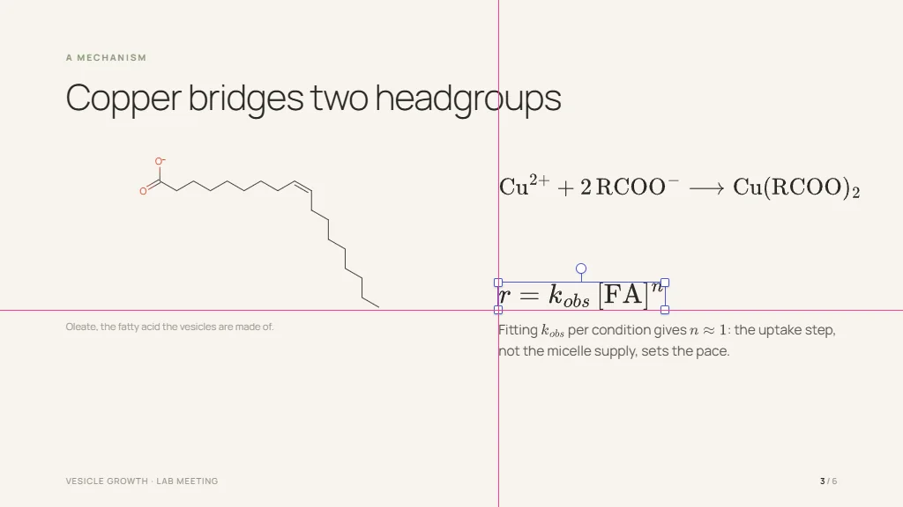
  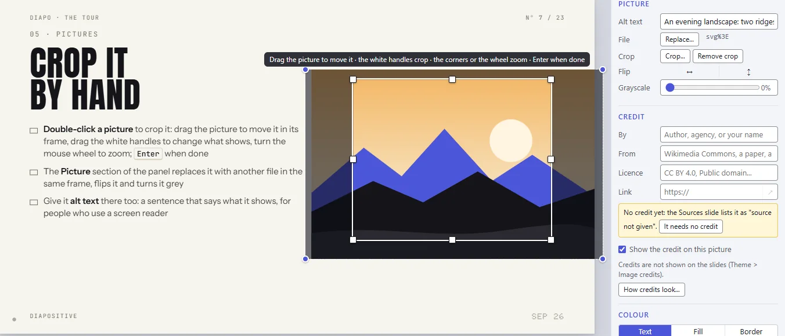
</p>

- **Layers** (Ctrl+Shift+L) lists what's on the slide front to back, so you can reach the thing hidden under the
  background, hide it, lock it, rename it or drag it up and down.
- **Find and replace across the whole deck** (Ctrl+F, Ctrl+H), speaker notes included if you want, formatting kept,
  and Replace all is one undo step.

<p>
  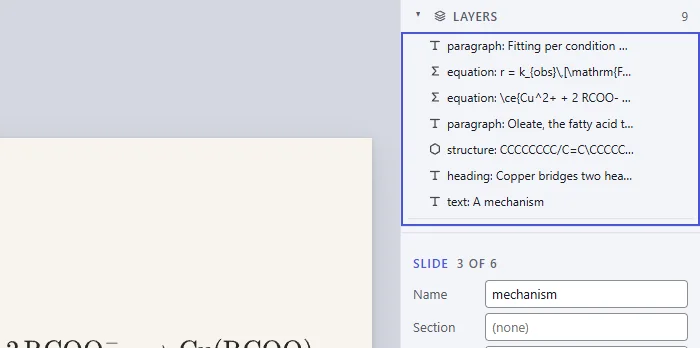
  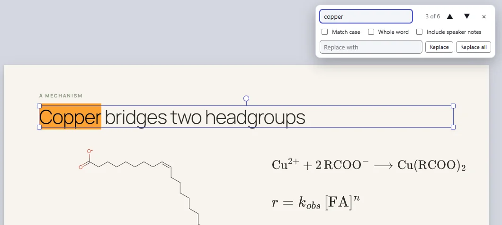
</p>

- **Copy style, paste style** (Ctrl+Alt+C, Ctrl+Alt+V) puts the look of one element on others; **Alt+drag** drops a
  copy where you let go.
- **Several decks in tabs**, each with its own undo, and whole slides copy and paste between decks with their
  pictures.
- **Maths and citations while you type**: Alt+= for an equation, Alt+[ or `[@` for a reference, without leaving the
  sentence.
- **Shrink to fit**: a text box can make its text smaller when it runs out of room, and bigger again when it has some.
- **Picture credits fill themselves in**: a picture from Wikimedia Commons comes with its author and licence, and one
  from any other page with its site.
- **Nothing gets lost.** Undo works for everything, unsaved changes are kept aside while you work and offered back if
  the window closes, and every save keeps the version before it (File > Previous versions).
- **Spelling** is checked while you type, and every control in the editor can be reached from the keyboard.

## Bringing your stuff along

You can import PowerPoint (.pptx) and Markdown files, and export a deck as a PDF, as a handout with your speaker
notes, as a single self-contained HTML file, as a folder ready to publish on a free web host you own (Netlify Drop,
GitHub Pages; Diapo hosts nothing itself), or back to an editable PowerPoint file, charts included.

AI-drafted decks open like any other, as long as they follow the [Diapo Format](diapo-format/README.md). The
[`diapo-deck`](skills/diapo-deck) skill teaches Claude Code to write them, so an assistant can draft the deck and you
can do the last touches by hand, which is exactly the workflow I was after. AI models are quite good at adding
effects and transitions to your slides, if you are into that sort of thing.

Other assistants (Claude Desktop, Cursor, a model running on your own machine, anything that speaks the Model Context
Protocol) can work on your decks through `deck-editor/mcp_server.py`, a small program the assistant starts: it lists,
reads and edits decks in your folder of decks, checks them, and shows the assistant a picture of a slide. Setting it
up is in [REFERENCE.md](deck-editor/REFERENCE.md#diapo-for-ai-agents-mcp).

## Nothing leaves your computer

Diapo runs locally: no account, no sign-in, no telemetry. It only goes online when you look up a Google Font, put a
video or web page from elsewhere on a slide, look up a reference by its DOI, or check for updates. Diapo checks
when it starts, at most once a day, by asking GitHub for the latest release; it sends nothing about you or your
decks, and "Check for updates when Diapo starts" (About Diapo, under the "?" button) turns it off. Your decks stay in
the folders you keep them in.

A deck that runs scripts of its own (often one written by hand or by an AI assistant) has them paused until you say
you trust it, since a script could read or change files on your computer. Decks made with Diapo never need it.

The MCP program sends nothing over the network either, and keeps the browser it draws slides with offline. What
leaves your computer when an assistant works on a deck depends on the assistant you connect: a cloud one sees what it
reads, a local model keeps everything local.

## Getting started

On Windows, the simplest route is the program itself. Download `diapo.exe` from the
[Releases](../../releases) page and double-click it; you don't need to install anything, Python included. The file
isn't signed yet, so Windows may warn you the first time that it comes from an unknown publisher.

On any system, Diapo also runs from this repository. All it needs is Python 3.8 or newer:

1. Download the repository (**Code > Download ZIP**, then unzip it), or clone it.
2. In the `deck-editor` folder, double-click `Start Diapo.bat` on Windows or `Start Diapo.command` on macOS (the
   first time, right-click > Open), or run `./start-diapo.sh` on Linux. From a terminal,
   `python3 deck-editor/serve.py [folder]` does the same (`py -3` on Windows).
3. Diapo opens on its welcome screen. Choose **Try the sample deck** for a tour (the one in the first screenshot), or
   **New deck** to pick one of the designs in the gallery. Everything about files (open, import, save as, previous
   versions, the folder your decks live in) is in the **File** menu.

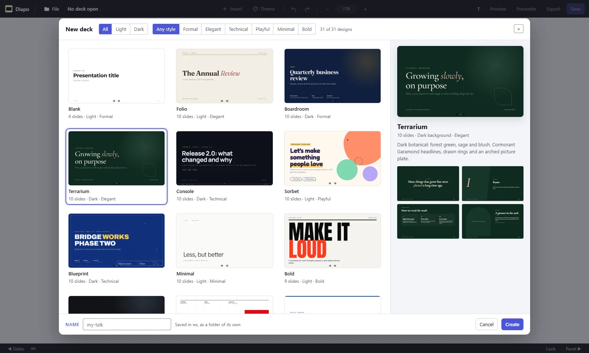

Diapo looks for Chrome or Edge first, because either one gives it a window of its own and prints PDFs directly.
Without them, it opens in a tab of your default browser, Firefox included, and PDFs are saved through the browser's
print dialog; only the picker for fonts installed on your computer needs Chrome or Edge. Started from the repository
for the first time, Diapo opens the `workspace/` folder.

## Documentation

- [Diapo in ten minutes](deck-editor/GUIDE.md), the short guide for people who make presentations.
- [Reference](deck-editor/REFERENCE.md), which covers every feature, the deck file contract, the keyboard, the server
  and the tests.
- [Diapo Format](diapo-format/README.md), the file format every deck follows, for anyone who wants to make decks
  without the editor.
- [Changelog](deck-editor/CHANGELOG.md).

## What is in this repository

| Folder | What it is |
|---|---|
| [`deck-editor/`](deck-editor) | The editor: plain HTML, CSS and JavaScript for the app, a server written with the Python standard library, and the tests |
| [`diapo-format/`](diapo-format) | The base styles, controller and runtime that every deck carries, published on their own |
| [`skills/`](skills) | The `diapo-deck` skill, with which Claude Code writes decks that Diapo can edit |

## Development

The app has no build step and installs nothing when it runs. npm is needed only for the tests and for the tools
that copy the icon, maths and chemistry libraries into the app:

```
cd deck-editor
npm install              # Playwright, and the packages the build tools copy from
npm test                 # browser tests in Chrome (in parts, side by side)
npm run test:firefox     # the same tests in Firefox (once before: npx playwright install firefox)
npm run test:py          # Python tests (Windows; elsewhere run the same unittest command with python3)
```

[Tests](deck-editor/REFERENCE.md#tests), in the reference, describes the rest.

## Why "Diapo"?

In Italian, slides are *diapositive*, and everyone just calls them *diapo*. Before projectors were plugged into
laptops, a diapositiva was a real thing you could hold: a small piece of 35 mm film, 36 × 24 mm, set in a plastic frame, which a projector threw onto a white screen in a dark room. I thought it fitting to use it as the Diapo logo as well.
I loved the ritual of setting those things up with my father when I was young so the name resonates a lot with me, but it might not have the same effect on people from outside of Italy. I still think the name is fun!


## AI Use

Diapo was built almost entirely with Claude Opus 5 and more recently with Opus 5.5. Some of the text you will read is slop-heavy (e.g. the test presentation is Claude-generated with small modifications), will try to clean some of that up over time but I don't find myself having much time these days :P

## License

Diapo is open source under the [MIT license](LICENSE), by Daniele Rossetto. The decks you make are yours, and the
format they follow is published separately under the same license, so no deck depends on Diapo to be shown.
Work by other authors that Diapo includes (templates, icons, fonts, and the MathJax and SmilesDrawer libraries) is
listed with its license in [THIRD-PARTY-NOTICES.md](THIRD-PARTY-NOTICES.md).
