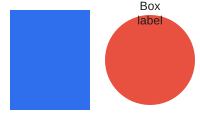

# Imported talk

A subtitle line

---

## Three points

- First point with **bold** and *italic*
- Second point with `code`
  - a nested point
- Third point [with a link](https://example.com)

<!-- Remember to breathe. -->

---

## A picture and some words

Text next to the picture.



---

## Code and a quote

```python
def hello():
    return "world"
```

> Simplicity is the ultimate sophistication.

---

## A table

| Name | Value |
|------|-------|
| alpha | 1 |
| beta | 2 |

Notes: the table is small.

---

# Section two

---

## Missing picture


